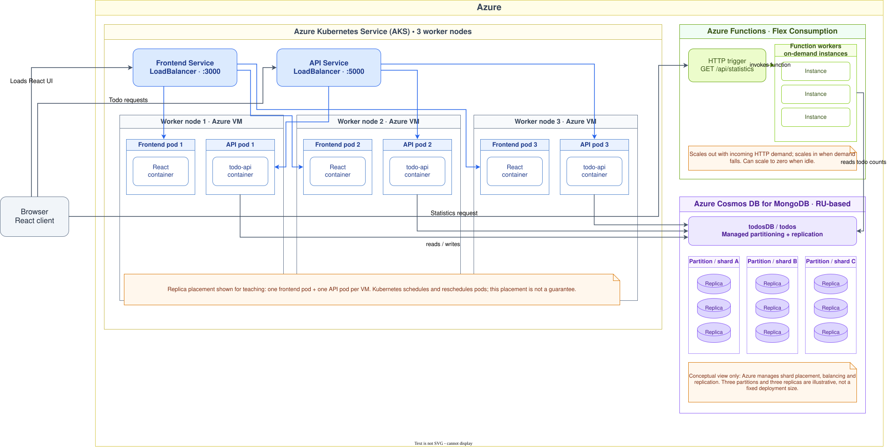
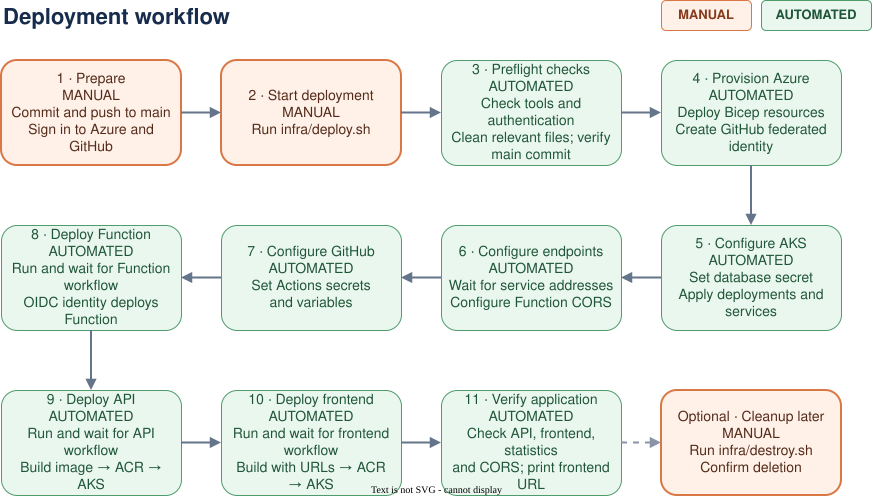

# CI/CD demo: GitHub Actions -> ACR -> AKS (student account, minimal cost)

Goal: a low-cost demo that works on an Azure for Students subscription.

- The deploy script creates the Function workflow's GitHub-federated Azure managed identity and role assignment.
- No MongoDB pod: the database is Azure Cosmos DB for MongoDB (free tier).
- Two small AKS nodes, free AKS control plane, ACR Basic.
- Each service has its own workflow, triggered by relevant pushes to `main` or manually in GitHub Actions.

The container workflows use GitHub secrets (ACR admin user + AKS kubeconfig). The Function workflow uses
OIDC and a managed identity instead. Treat the kubeconfig and registry credentials as sensitive. The identity
is created inside the demo resource group and is removed when that group is deleted.

## Overview diagrams

### Application architecture

[](diagrams/todo-cloud-AKS.drawio)

### Automated deployment

[](diagrams/deployment-workflow.drawio)

## Rough cost

| Resource                   | Choice                       | Cost                          |
| -------------------------- | ---------------------------- | ----------------------------- |
| AKS control plane          | Free tier                    | $0                            |
| AKS nodes                  | 2 x `Standard_B2s_v2`        | ~ $60-110/month if left running; size and region dependent |
| ACR                        | Basic                        | ~ $5/month                    |
| Cosmos DB for MongoDB (RU) | Free tier (1000 RU/s, 25 GB) | $0                            |
| Public IPs                 | 2 x LoadBalancer             | ~ a few $/month               |
| Function App and storage   | Flex Consumption and LRS     | Usage-based; varies by region |

**Delete the demo resources when finished:** run `bash infra/destroy.sh` and confirm when prompted. It starts
deleting `todo-rg` in the background. Alternatively, delete the group directly with
`az group delete -n todo-rg --yes`. Both options delete all resources in the group.
You can also pause the cluster between sessions: `az aks stop -g todo-rg -n todo-aks` (and `az aks start ...`).
The node estimate is approximate; actual pricing varies by region. Set `AKS_NODE_COUNT=1` for a lower-cost demo.

## Prerequisites

The scripts use command-line tools. The Azure extensions for VS Code are not needed and do not replace them.
Run the commands in the VS Code integrated terminal (bash).

| Tool              | Needed for                           | Install                                                                                                                                                           |
| ----------------- | ------------------------------------ | ----------------------------------------------------------------------------------------------------------------------------------------------------------------- |
| Azure CLI (`az`)  | everything in `infra/`               | macOS: `brew install azure-cli`<br>Windows: `winget install -e --id Microsoft.AzureCLI`<br>Linux: <https://learn.microsoft.com/cli/azure/install-azure-cli-linux> |
| `kubectl`         | secrets and deployments in AKS       | after installing `az`: `az aks install-cli` (or `brew install kubectl`)                                                                                           |
| GitHub CLI (`gh`) | configures and runs GitHub workflows | macOS: `brew install gh`<br>Windows: `winget install -e --id GitHub.cli`<br>then `gh auth login`                                                                  |
| Git               | clone and push the repository        | Windows: `winget install -e --id Git.Git`<br>Other platforms: <https://git-scm.com/install/>                                                                      |
| Bash              | running the scripts                  | built in on macOS/Linux; on Windows use Git Bash or WSL                                                                                                           |
| `curl`            | verifies deployed services           | Included in most current operating systems                                                                                                                        |
| Node.js 22        | validates endpoint responses         | <https://nodejs.org/>                                                                                                                                             |

Check the installation and sign in. **After installing, close and reopen the terminal, or restart VS Code completely**
(on Windows, sign out and in again if `az` is still not found). Terminals only pick up new tools at startup.

```bash
az --version
az login            # opens a browser; sign in with your student account
az account show     # confirm the right subscription is selected
```

If several subscriptions are listed, choose the student one: `az account set --subscription "<name or id>"`.

**Cloud Shell alternative:** use Azure Cloud Shell (<https://shell.azure.com>, choose Bash). It already has `az`,
`kubectl` and Bicep, and you are already logged in. Check that GitHub CLI and Node.js are available, install them
if needed, run `gh auth login`, then `git clone` the repo and run the scripts.

## Deploy your own copy

Follow these steps in a Bash terminal. On Windows, use Git Bash or WSL. Install the tools in
**Prerequisites** first. Docker is not needed locally: GitHub Actions builds the container images.
Deployment creates billable Azure resources; review **Rough cost** and clean up when finished.

### 1. Fork and clone the repository

1. Sign in to GitHub and open <https://github.com/pesekt1/todo-cloud>.
2. Select **Fork** and create a fork under your own GitHub account. Keep the `main` branch.
3. Open your fork's **Actions** tab and enable workflows if GitHub prompts you to do so.
4. Clone your fork, replacing `YOUR-USERNAME` with your GitHub username:

   ```bash
   git clone https://github.com/YOUR-USERNAME/todo-cloud.git
   cd todo-cloud
   git remote -v
   ```

Check that `origin` points to your fork, not the original repository. If you named your fork differently,
use its actual clone URL. You need permission to manage its Actions secrets and variables and run workflows.

### 2. Sign in

```bash
az login
az account list --output table
az account set --subscription "<student subscription name or id>"
az account show --output table
gh auth login
gh auth status
kubectl version --client
```

Confirm that the selected Azure subscription is the one you intend to use and that `gh` is signed in to the
GitHub account that owns your fork. Your Azure account needs permission to create resources, register resource
providers, and assign roles.

### 3. Check regions and prepare your repository

The defaults are `swedencentral` for AKS, ACR and Cosmos DB, and the AKS region for the Function App and its
storage. Your subscription may have different policy restrictions, quotas, or available capacity.
List Azure regions and regions that support the Function's Flex Consumption plan:

```bash
az account list-locations --query "[].{Name:name, DisplayName:displayName}" -o table
az functionapp list-flexconsumption-locations -o table
```

A region appearing in a list does not guarantee that your subscription permits it or has capacity for every
resource. Choose suitable regions if the defaults are unavailable; you can supply them in the next step.
The Function and its storage must use a region that supports Flex Consumption.

A subscription-level allowed-regions policy rejects every other region with `RequestDisallowedByAzure`. Show the
regions this subscription currently permits:

```bash
az policy assignment show -n sys.regionrestriction --query parameters.listOfAllowedLocations.value -o tsv
```

Pick a region from that list that also appears in the Flex Consumption list above, and use it for all three
variables below so the whole stack lives in one permitted region.

From your cloned fork, check your branch and working tree:

```bash
git status
git branch --show-current
git remote -v
```

Use `main`. If you change application, infrastructure, manifest, or workflow files, commit and push those
changes to your fork's `main` before deploying. The local commit must match your fork's `main`, and those
files must have no uncommitted changes. Push-triggered workflows may fail before the infrastructure and
GitHub settings exist; the deploy script runs them again after configuring everything.

If your local `main` is behind your fork and you have no uncommitted changes, update it:

```bash
git switch main
git pull --ff-only origin main
```

### 4. Deploy the demo

The script reuses the resource group `todo-rg` if it already exists, and cleanup deletes the entire group.
If that group contains resources you need to keep, choose a new group and include `RG=<group-name>` in your
deployment command; use the same group name when cleaning up.

From the repository root, use the defaults if they are suitable:

```bash
bash infra/deploy.sh
```

Or replace the following example regions with regions suitable for your subscription:

```bash
LOCATION=italynorth COSMOS_LOCATION=italynorth FUNCTIONS_LOCATION=italynorth bash infra/deploy.sh
```

`LOCATION` sets the AKS and ACR region, `COSMOS_LOCATION` sets the Cosmos DB region, and
`FUNCTIONS_LOCATION` sets the Function App and its storage region. If deployment fails because a region is
restricted or lacks capacity, choose another region and rerun the command. An existing resource group's
location does not change, and changing a setting does not move an existing Cosmos DB account. Use a new
resource group via `RG=<group-name>` if existing resources must remain in their current regions.

The script normally detects your fork from the current repository. If necessary, explicitly select it with
`GITHUB_REPO=YOUR-USERNAME/todo-cloud bash infra/deploy.sh`, using your fork's actual owner and name.

The script deploys [infra/main.bicep](../infra/main.bicep) (ACR, AKS, Cosmos DB, Function App,
storage, and the GitHub managed identity), configures the database secret, and renders the registry
name into the AKS manifests without changing the files. It applies the manifests, waits for public IPs,
configures Function CORS and GitHub secrets and variables, then triggers and waits for all three workflows.
Finally it verifies the API, frontend, Function and CORS, and prints the frontend URL.

### 5. Verify the demo

Open the printed frontend URL. Add a todo, complete it, and check that the statistics update. In your fork's
**Actions** tab, check that the Function, API, and frontend workflows succeeded. If deployment or verification
fails, see **Troubleshooting** below.

When finished, follow **Clean up** below to delete the demo resources and avoid further charges.

The Function reads the same Cosmos database as the API. Its database connection is stored in Azure app
settings, not in the frontend or GitHub. Do not commit credentials or kubeconfig. The API's existing
seed script replaces the todos whenever the API starts, including during deployment and restarts.

Other settings can also be overridden with environment variables, for example
`AKS_VM_SIZE=Standard_B2s_v2 bash infra/deploy.sh`. Include your region overrides again when rerunning the
script if you do not want to use the defaults. Not every VM size is permitted in every subscription or region:
if preflight validation rejects the size, it lists the sizes that are allowed.
The default AKS node count is two (`AKS_NODE_COUNT=1` overrides it). Existing clusters do not change until you
redeploy or scale the node pool manually:

```bash
az aks scale -g todo-rg -n todo-aks --nodepool-name system --node-count 2
az aks get-credentials -g todo-rg -n todo-aks --admin
kubectl config current-context  # confirm this is the AKS context
kubectl get nodes
kubectl get pods -l app=todo-api -o wide
```

The deploy script uses a temporary kubeconfig and does not change your current `kubectl` context.
The `get-credentials` command above adds admin credentials to your normal kubeconfig; treat them as sensitive.

An additional node does not guarantee that replicas run on different nodes; existing pods are not automatically
redistributed. Switching or scaling nodes can affect availability, and the extra VM consumes student credits.

## Observe the deployment in Azure portal

Sign in to the [Azure portal](https://portal.azure.com), open **Resource groups**, and select `todo-rg`
(or the group named by `RG`). The resource group is the starting point for the resources created by this demo.
Use the resource names printed by `infra/deploy.sh` if you have changed the defaults.

### Resource and network overview

The public IPs and load balancers for the Kubernetes `LoadBalancer` services are managed in the AKS node
resource group, whose name starts with `MC_`; the cluster's **Properties** page shows its name. The deployment
does not create a custom VNet, private endpoints, or a firewall path between these services. The frontend and
API services are public; Cosmos DB and the Function App also use their Azure service endpoints.

### Portal walkthrough

Start at the resource group's **Overview** page to see the resources created for the demo. Open **Deployments**
to review the Bicep deployment and whether resource provisioning succeeded. The resource group's **Activity log**
shows Azure management operations and failures; it is not a record of requests handled by the application.

Open the AKS resource (`todo-aks` by default) and select **Kubernetes resources**. In **Workloads**, check that
the `todo-app` and `todo-api` deployments have ready pods. In **Services and ingresses**, find the frontend
and API services and their external IP addresses. These IPs are the public entry points for the application.
The **Nodes** view shows the system node pool and its node health. Portal labels can vary by version and
permissions.

To follow the public network path, use the cluster's **Properties** page to find its AKS-managed node resource
group, usually named `MC_...`. Open that group to inspect the Azure load balancers and public IP resources
created for the Kubernetes services. Treat these as AKS-managed resources; do not modify them directly.
This deployment uses public service IPs and does not create a custom VNet or private endpoints.

Next, open the Container Registry and check **Repositories** for the frontend and API images produced by the
GitHub Actions workflows. In the Function App, open **Functions** to locate the statistics endpoint; the
**Monitor** view may show invocation details depending on the available monitoring configuration. The Cosmos
DB account's **Metrics** page shows account-level request, availability, and capacity data. These separate
resource views help trace the application path: the browser reaches the public AKS services and Function App,
while the API and Function read or write data in Cosmos DB.

For a quick health check, confirm that both AKS services have external IPs, the expected pods are ready, and
the latest workflow images appear in ACR. Compare these with the frontend URL and verification output printed
by the deploy script.

### Monitoring and logs

The deployment does **not** configure Container Insights, a Log Analytics workspace, Azure Managed Prometheus,
Application Insights, or alert rules. Azure portal resource metrics, health, and the Activity log are useful
for basic inspection, but pod/container logs and cluster-level dashboards require enabling the relevant Azure
Monitor integration. From the AKS resource, open **Insights** or **Monitoring** and follow the setup prompt to
associate or create a Log Analytics workspace. Review workspace retention and pricing before enabling it;
ingestion and retention can incur charges. Enabling monitoring is an additional configuration step and does
not change the deployment's existing Bicep setup.

Opening **Insights** before monitoring is configured may show a prompt rather than workload logs. The Function
App and Cosmos DB metrics are separate from AKS container monitoring; detailed Function logs may require
Application Insights.

### Optional: Inspect AKS with Lens

[Lens K8S IDE](https://docs.lenshq.io/k8slens/) provides a graphical view of Kubernetes resources, including
nodes, workloads, pods, services, events, and pod logs, subject to your cluster permissions. To connect it to
this cluster, add AKS credentials to your local kubeconfig, then select that cluster in Lens:

```bash
az aks get-credentials -g todo-rg -n todo-aks
```

Use the resource group and cluster names used for your deployment. Prefer a least-privilege account and treat
the kubeconfig as sensitive. Lens complements the Azure portal; it does not show Azure resource-group
deployments, Azure load balancers and public IP resources, ACR, the Function App, or Cosmos DB metrics.
Metrics availability depends on the cluster's metrics APIs and configuration.

### Troubleshooting

**Interrupted deployment:** You can usually rerun `bash infra/deploy.sh` without deleting the resource group.
First, wait for any Azure deployment or GitHub workflows still in progress to finish. Use the same subscription
and any original environment overrides, including `RG` and region settings. The script reapplies the
configuration and reruns the workflows; it does not resume from the interrupted step. If it fails, check the
reported error before retrying. Restarting the API can replace existing todos. Use `destroy.sh` only if you
intend to delete the entire resource group and its data.

If the deployment fails: select a region allowed by your subscription policy, use `ATTACH_ACR=false` if the
AKS-to-ACR role assignment is denied, and `COSMOS_SERVERLESS=true` when the free tier is already used.
The Function identity still requires permission to create its separate role assignment.
The frontend embeds both API URLs at image build time. The workflow uses a unique image tag per run,
so rerunning it after updating a URL deploys the new configuration even for the same commit.
The API workflow also uses a unique tag so an updated database secret is loaded by the new API pod.
`FRONTEND_ORIGIN` can override the discovered origin when using a custom frontend address.
The Function is anonymous and CORS is not an authorization mechanism; this is a public demo endpoint.
Monitor Function errors and MongoDB connections, particularly if the Function scales out.
If role assignment is denied, ask a subscription administrator for the required permission.
New Azure identity and role assignments can take time to propagate; if Function authentication fails
immediately after provisioning, wait a few minutes and rerun the script.

### Clean up

```bash
bash infra/destroy.sh
```

Confirm with `y`. The script deletes the entire `todo-rg` resource group asynchronously, including its data.
For a custom group use `RG=<group-name> bash infra/destroy.sh`. Verify deletion has finished in the Azure portal
or with `az group exists -n todo-rg`; also check that the AKS-managed `MC_...` group has disappeared.
Unrelated groups such as `NetworkWatcherRG` are not targeted.
Alternatively, run `az group delete -n todo-rg --yes` to delete the default group directly.

Deleting the resource group does not remove the GitHub Actions secrets and variables created by the deploy
script. They refer to the deleted resources and are overwritten on the next deployment. If you no longer
need them, remove them in the repository's **Settings -> Secrets and variables -> Actions**.
