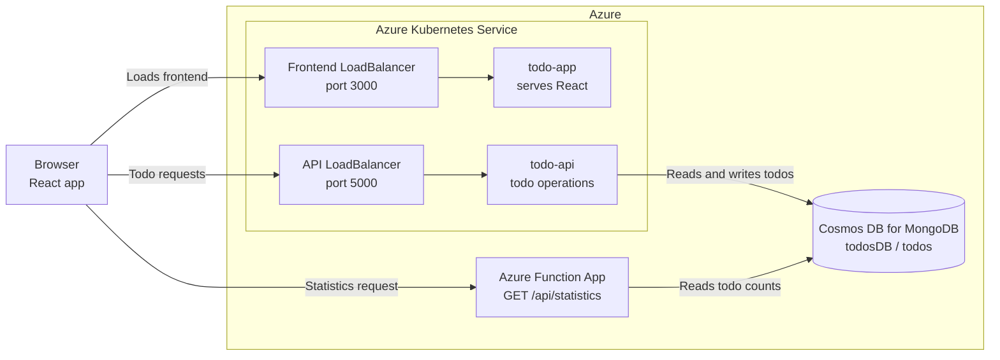

# Application architecture

The browser calls the API and Function directly. The Function is an anonymous endpoint; CORS allows the
configured frontend origin but does not provide authorization. The API's demo seed replaces todos on startup.
