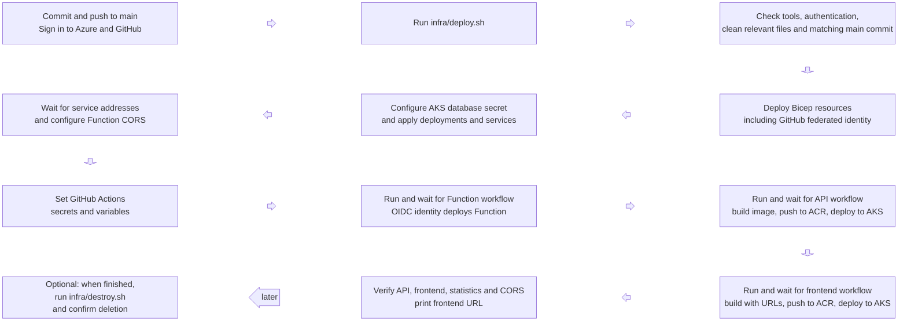

# Automated deployment

The script stops if a step fails. Azure identity permissions may take time to propagate; see the
[deployment guide](../cicd-aks-acr.md) for prerequisites and troubleshooting.
